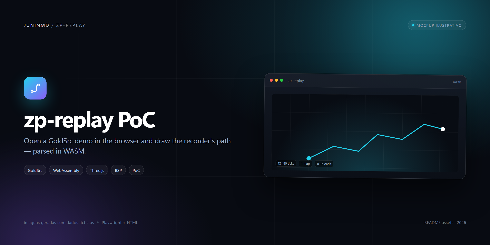
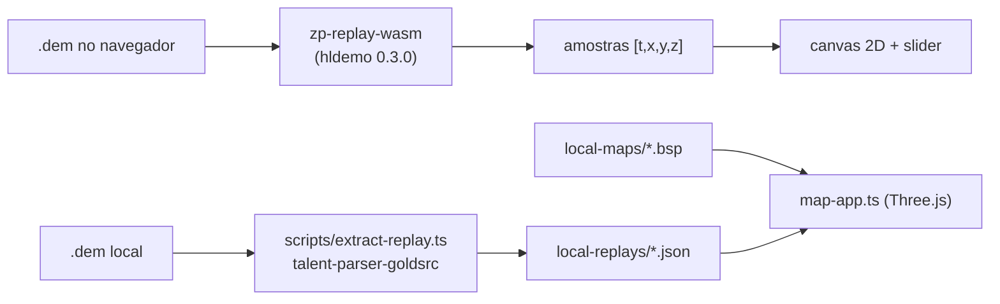
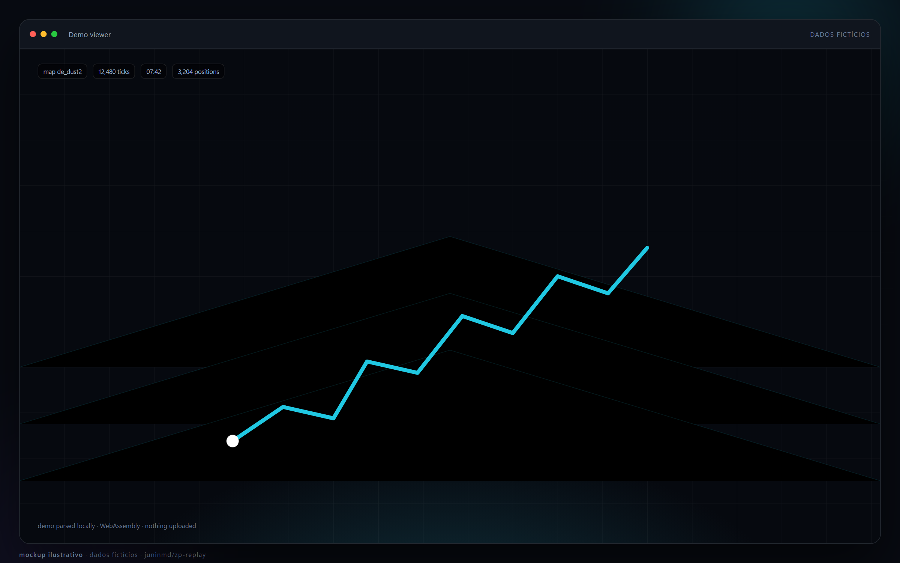
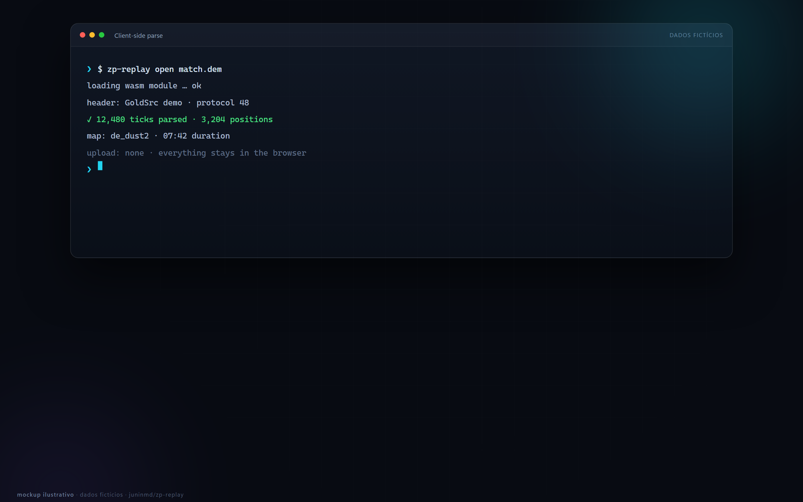

# zp-replay PoC

<p align="center">
  
</p>

**Abrir um demo GoldSrc (`.dem`) no navegador e desenhar a trajetória do jogador que gravou.**

O parse roda no cliente via WebAssembly, então o arquivo não sai da máquina. Há também um
viewer 3D que carrega a geometria de um mapa BSP e as trilhas de posição de uma partida
inteira, geradas offline.

[](https://github.com/juninmd/zp-replay/actions/workflows/validate.yml)

> **Isto é uma prova de conceito, não um player de demos.** Não substitui CS 1.6, HLAE ou
> qualquer ferramenta de replay madura. O que funciona e o que não funciona está separado
> abaixo de propósito.

## O que a PoC faz

- **Upload e parse no browser:** você escolhe um `.dem`, o WebAssembly lê os frames
  `ClientData` e devolve as posições do gravador.
- **Viewer 2D:** trajetória em canvas, com slider de tempo e o ponto atual destacado.
- **Viewer 3D:** carrega um `.bsp` (hoje `de_dust2`) e um JSON de replay; tem visão de cima,
  câmera livre e primeira pessoa nos spawns.
- **Modo POV:** quando o demo é uma gravação em primeira pessoa (não HLTV), a câmera segue a
  posição e os ângulos do gravador.
- **Extrator offline:** converte `.dem` em JSON com trilhas de posição por entidade, a até
  10 Hz, para o viewer 3D não precisar parsear a partida no navegador.

## O que a PoC NÃO faz

### Limite do caminho WebAssembly

- **Só a posição do gravador é extraída no browser.** Ela vem dos frames `ClientData`. As
  posições dos outros jogadores e bots estão em mensagens `svc_packetentities`,
  delta-comprimidas, que o `hldemo` vendorizado entrega como bytes brutos
  (`NetMsgData.msg`) — o crate não decodifica entidades.
- Por isso o viewer 2D mostra **uma** trajetória, não a partida.

### Limite do extrator do viewer 3D

O extrator offline usa outro parser (`@cgdangelo/talent-parser-goldsrc`) e **consegue**
decodificar `SVC_PACKETENTITIES` / `SVC_DELTAPACKETENTITIES`. Ainda assim:

- as trilhas são indexadas por **slot de entidade**, não por jogador: não há nome, SteamID,
  time, vida, arma nem killfeed;
- um slot reutilizado depois de uma desconexão continua na mesma trilha;
- demos HLTV não têm POV (o `ClientData` vem com origem zero e é descartado);
- a posição é interpolada linearmente entre amostras e some depois de 5 s sem atualização
  (`STALE_AFTER_S`), em vez de extrapolar;
- não há som, eventos, chat, granadas, tiros nem lógica de jogo.

### Limite do viewer 3D

- O mapa é **fixo em `de_dust2.bsp`** (`/maps/de_dust2.bsp`); não há seletor de mapa.
- O leitor de BSP pega só geometria, entidades e bounding box: **sem texturas, lightmaps ou
  árvore BSP/PVS**. As faces são coloridas por um hash do nome da textura, e céu/CLIP/sky
  são escondidos.
- Não existe overview calibrado do mapa: a escala do viewer 2D é a bounding box da
  trajetória.

## Como rodar

Pré-requisitos: [Bun](https://bun.sh) e uma toolchain Rust com o target
`wasm32-unknown-unknown` (o `pretest` instala o target, mas não o Rust).

```bash
git clone https://github.com/juninmd/zp-replay.git
cd zp-replay
bun install
bun run build:wasm     # compila o crate e copia o .wasm para web/
bun run test           # 22 pass, 4 skip, 0 fail num clone sem demos locais
bun scripts/serve.ts   # http://localhost:8080
```

### Viewer 2D

Abra `http://localhost:8080/` e escolha um `.dem`. O `web/zp_replay_wasm.wasm` é gerado por
`bun run build:wasm` e é gitignored; sem ele a página não carrega.

### Viewer 3D

Os assets do jogo ficam fora do git, em pastas locais:

```bash
bun run build:web                              # gera web/map-app.js (gitignored)
mkdir -p local-replays local-maps
bun scripts/extract-replay.ts partida.dem local-replays/partida.json
cp de_dust2.bsp local-maps/                    # asset do CS 1.6, não versionado
bun scripts/serve.ts
# http://localhost:8080/map.html?replay=partida.json
```

O servidor (`scripts/serve.ts`) serve `web/`, e expõe apenas `local-maps/*.bsp` e
`local-replays/*.json`, com validação de nome e bloqueio de `..`. A porta vem de `PORT`
(padrão `8080`). No PowerShell, troque `mkdir -p` por
`New-Item -ItemType Directory -Force local-replays, local-maps` e `cp` por `Copy-Item`.

## Arquitetura



### O ABI do WebAssembly

O crate `crate/` é uma `cdylib` mínima sobre o `hldemo`:

| Export | Uso |
|---|---|
| `alloc(len)` | reserva bytes na memória wasm para o host copiar o demo |
| `dealloc(ptr, len)` | libera o buffer |
| `parse_origins(ptr, len)` | parseia o demo e guarda as amostras; retorna a contagem ou `-1` |
| `samples_ptr()` | ponteiro para o array `f32` plano `[t, x, y, z, …]` |

O JavaScript copia as amostras para um `Float32Array` próprio antes de qualquer nova
alocação, porque um `alloc` posterior pode crescer a memória e desanexar a view. O viewer 3D
usa o JSON, não o wasm.

O `vendor/hldemo` é uma cópia da versão **0.3.0**, com as licenças MIT/Apache-2.0 do
upstream. A única alteração é remover o `;` final de duas expansões da macro `map_res_err_`
em `src/parse/macros.rs`, que o `rustc` atual rejeita — sem o patch o crate não compila.

## Testes e verificação

```bash
bun run test
```

Resultado num clone limpo, com Bun 1.3.13 e Rust 1.99.1: **22 pass, 4 skip, 0 fail**.

Os 4 skips são fixtures que não estão no repositório:

- `vendor/hldemo/test-demos/basic.dem` — pasta gitignored; o teste do parser foi escrito
  contra 288 amostras e a primeira posição `(0, 484, 318, -203.96875)`, mas só roda se você
  colocar o fixture lá;
- `local-maps/de_dust2.bsp` — asset do jogo, gitignored; o teste do leitor BSP espera 5130
  faces e 20 spawns por time;
- dois demos reais (HLTV e POV) usados no teste de trilhas. Esses testes têm **caminhos
  absolutos da máquina do autor** (`C:/Users/.../navi-vs-fx-dust2.dem` e
  `.../demotest.dem`), então são pulados em qualquer outro checkout.

Os testes de unidade que não dependem de fixture cobrem: rejeição de lixo no wasm, delta de
origem que muda só `z`, baseline, filtro de entidades fora de `1..maxPlayers`, thinning de
0,1 s, `ClientData` de HLTV, interpolação, staleness e duração.

## Privacidade

O parse do viewer 2D acontece no navegador; nada é enviado. O JSON gerado pelo extrator
contém apenas nome do mapa, `maxPlayers`, trilhas de posição e a POV — **não contém nomes,
SteamID nem chat**, porque o extrator não lê esses campos. O demo original, claro, pode
conter tudo isso; ele continua sendo seu arquivo.

## Screenshots

> [!NOTE]
> **Illustrative mockups.** The screens below were rendered from HTML with fictitious data (Playwright). They are not captures of a real installation.

<p align="center">
  
  <br>
  <sub>Demo viewer — fictitious data.</sub>
</p>

<p align="center">
  
  <br>
  <sub>Client-side parse — fictitious data.</sub>
</p>


## Limitações e próximos passos

- Levar a extração de entidades para o wasm (hoje ela existe só no extrator offline) exigiria
  implementar o decoder de `svc_packetentities` em Rust ou portar a lógica do
  `talent-parser`.
- Resolver identidade de jogador (nome/time) e reuso de slot para o replay fazer sentido
  como partida.
- Overview calibrado do mapa para escala real.
- Sanitização antes de publicar qualquer replay.
- O repositório não tem workflow próprio de build ou teste do wasm: `validate.yml` chama a
  validação padrão do `juninmd/base-actions`, e o build/teste acima foram rodados localmente.

## Licença

O repositório **não tem arquivo de licença**. O `vendor/hldemo` mantém as licenças
MIT/Apache-2.0 do upstream, mas isso cobre apenas a cópia vendorizada, não o código deste
projeto.
